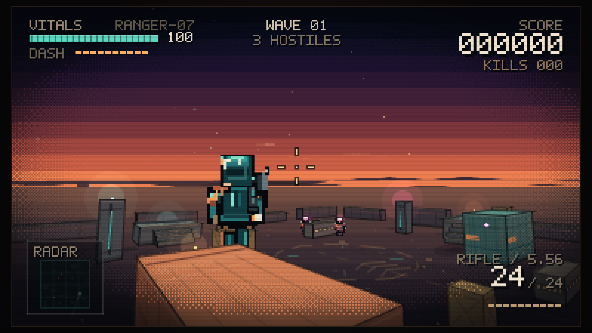
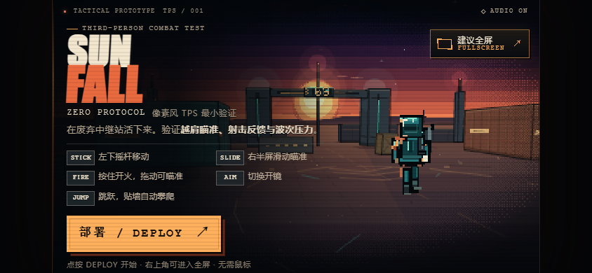
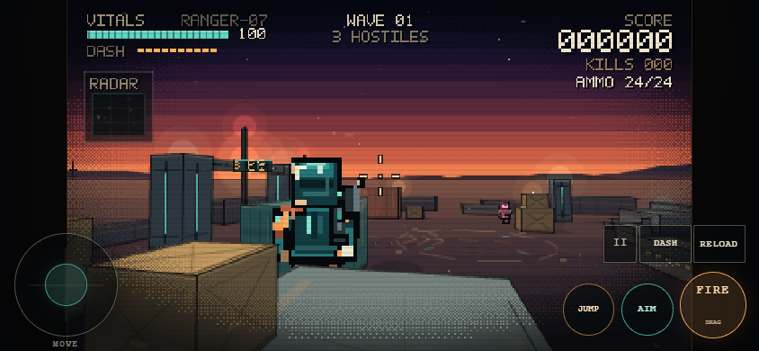

# SUNFALL / ZERO PROTOCOL

一个可玩的**像素风第三人称射击（TPS）最小验证 Demo**。

单文件 HTML，零外部依赖：像素美术、场景、角色、HUD、音效全部由 Canvas 2D + Web Audio 在运行时生成。

## 运行

直接双击 `index.html`，用桌面版 Chrome / Edge 打开即可；手机用浏览器打开同一文件。

- 桌面：推荐全屏，戴耳机。
- 手机：请将手机旋转为**横屏**；无需鼠标。
- 进入全屏：点击右上角的 **「建议全屏 / FULLSCREEN」**；游戏开始后可随时按暂停，点击卡片右上角的 **「全屏 / FULL」**。
- 如果浏览器不支持网页全屏（例如 iPhone 上的 Safari），页面会提示改用浏览器全屏菜单，或通过「分享 → 添加到主屏幕」获得沉浸体验。
- 桌面点击「部署 / DEPLOY」后浏览器会尝试锁定鼠标。如果鼠标锁定被拒绝：按住 **鼠标右键并拖动** 转向（同时进入瞄准），也可用 **方向键** 转向/抬枪。底部会出现提示。
- 游戏内按 **M** 静音。

## 操作

### 桌面

| 输入 | 动作 |
|---|---|
| `WASD` | 移动 |
| 鼠标 | 越肩视角瞄准 |
| 左键 | 射击（按住连发） |
| 右键 | 瞄准 / ADS（降低扩散、拉近视野） |
| `Space` | 跳跃；朝台沿/箱子/集装箱推进时自动攀爬翻越 |
| `Shift` | 冲刺（短暂无敌帧） |
| `R` | 换弹 |
| `方向键` | 转身 / 抬枪（无鼠标锁定时的备用视角） |
| `Esc` | 暂停 / 继续 |
| `M` | 静音 |
| `Enter` | 菜单快速开始 / 结算快速重开 |

跳跃高度约 0.85 个世界单位（约半个身位）：低矮掩体可以直接跳上，1.5 米以上的台面需要贴边攀爬。
准星上方出现 `SPACE CLIMB` 时，说明前方台沿在攀爬判定内。

### 手机 / 触屏

| 操作 | 动作 |
|---|---|
| 左下虚拟摇杆 | 移动 |
| 右半屏滑动 | 转向 / 抬枪 |
| `FIRE` 按钮 | 按住连发；按住时滑动可边射边瞄 |
| `AIM` 按钮 | 切换瞄准 / ADS |
| `JUMP` 按钮 | 跳跃 / 贴边攀爬（准星提示 `JUMP CLIMB` 时可用） |
| `DASH` | 冲刺 |
| `RELOAD` | 换弹 |
| `II` | 暂停 |

触屏模式自动开启：左上角会显示紧凑雷达，弹药改为右上角数字；准星带有轻微辅助吸附，方便手指瞄准。竖屏时会显示旋转提示，建议横屏游玩。

## 这个 Demo 验证的内容

- **越肩第三人称相机**：肩部偏移、ADS 拉近、相机与掩体碰撞、命中反馈；垂直方向带阻尼跟随，起跳时角色会在画面里"升起"，落地有下沉与震动。
- **3C 基础动作**：走 / 冲刺 / 跳跃 / 攀爬翻越；带 coyote time（离台后仍可起跳）、跳跃缓冲、可变跳跃高度、空中控制、自动小台阶上下（≤0.34 米）与落地压缩、扬尘、音效。
- **立体地形**：西侧带楼梯的双层货台、北侧装卸屋顶（三级台阶）、集装箱顶攀爬路线（矮箱→箱顶）、可翻越的低掩体；台面可以站立、架枪、跳下，敌人只能在地面绕行。
- **射击手感**：hitscan、爆头判定、枪口火光、tracer、弹着火花、伤害数字、命中标记、后坐力、屏幕震动。
- **战斗循环**：Grunt / Brute 两种敌人、延迟开火的弹丸、视线检测（按玩家所在高度计算）、简单掩体绕行、波次递增。
- **生存循环**：生命值、冲刺无敌帧、换弹、击杀得分、波次奖励、死亡结算与重开。
- **像素表现**：384×216 内部分辨率 + 最近邻放大、程序化像素角色/场景、抖动渐变、CRT 扫描线、像素字体 HUD、空中收腿帧。
- **桌面 / 触屏双端**：桌面用鼠标锁定 + 键盘；触屏用虚拟摇杆 + 右半屏滑动 + 开火/瞄准/跳跃/冲刺/换弹按钮。竖屏会显示旋转提示。
- **全屏引导**：开始页右上角常驻「建议全屏」；开始后可从暂停菜单进入全屏。独立窗口模式会自动隐藏该提醒；浏览器不支持时给出 Safari / 添加到主屏幕的替代说明。
- **零资产依赖**：没有图片、字体或音频文件；所有内容内联生成。

## 原型边界

这是一个验证手感和视觉方向的最小原型，不是生产级游戏：

- 敌人和角色使用 billboard 精灵，遮挡关系是按深度排序的近似结果。
- 掩体绕行是简单的方向采样，不是完整导航网格；敌人不会攀爬，只会在地面贴着台子打转。
- 攀爬是固定时长的翻越动画，没有悬挂、横向挪移或墙跑；空中只有一层跳跃。
- 触屏准星只有很轻的辅助吸附，不是自动瞄准；摇杆/滑动都做了 pointer capture，但个别旧版 iOS Safari 的手势冲突可能仍需调试。
- 没有蹲伏、武器切换、存档、联网或性能分级。
- 音频需要一次用户手势才能启动。

## 文件

- `index.html` — 完整可玩 Demo（单文件）。
- `preview.png` — 桌面实际游玩画面。
- `mobile-preview.png` — 手机横屏触控布局。
- `fullscreen-preview.png` — 开始页的全屏引导。
- `README.md` — 本说明。

## 调试覆盖

- 自动检测触屏；也可以用 `?touch=1` 强制触屏布局，用 `?desktop=1` 强制桌面布局。
- 桌面和触屏都测试过移动、瞄准、射击、换弹、冲刺、跳跃 / 攀爬、暂停、复活 / 重开。
- 触屏测试覆盖虚拟摇杆、右半屏滑动、开火拖动瞄准、AIM 切换、JUMP、RELOAD、DASH、暂停。
- 高度相关实测：平地起跳顶点 ≈0.83、楼梯逐级 0.3→0.6→0.9→1.2→1.5、贴台沿攀爬到 1.5、矮箱 0.95 → 集装箱 2.55 的两段攀爬、从台面走落回地面均正常。
- 全屏 API 不可用或请求被拒绝时，会显示可操作的替代提示，不影响继续游戏。
